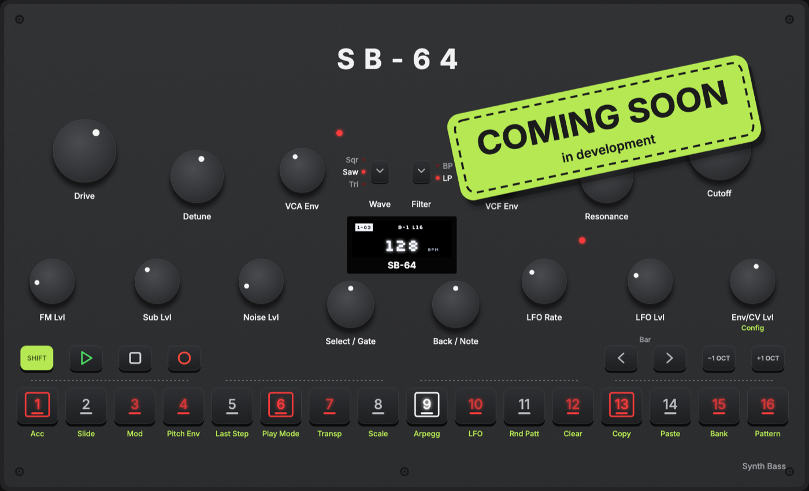

# SB-64

Analog-style acid bassline synthesizer plugin with a 64-step sequencer. Planned as AU, VST3 and CLAP
for macOS, Windows and Linux, built with JUCE.

> **Status: planning.** Nothing to download yet.

## Planned features

- **Voice:** one oscillator (saw, square, triangle) with a sub oscillator one octave down, noise and
  audio-rate FM from the LFO
- **Detune:** bucket-brigade style doubling for a wide, swarming unison sound
- **Filter:** aggressive two-pole low-pass/band-pass filter that self-oscillates without losing the bass
- **Drive:** blend from gentle saturation to raw distortion
- **Envelopes:** amp and filter envelopes, per-step pitch envelope for percussive "peow" hits
- **LFO:** ten shapes, free or tempo-synced, retrigger per step, start phase
- **Sequencer:** up to 64 steps with per-step gate, accent, slide, cutoff modulation, pitch envelope,
  probability and micro-tuning; play directions, swing, transpose, scales (incl. microtonal user scales),
  arpeggiator and a random pattern generator
- **Memory:** 8 banks × 16 patterns, pattern chaining
- **MIDI:** play it from a keyboard, sync to the host tempo
