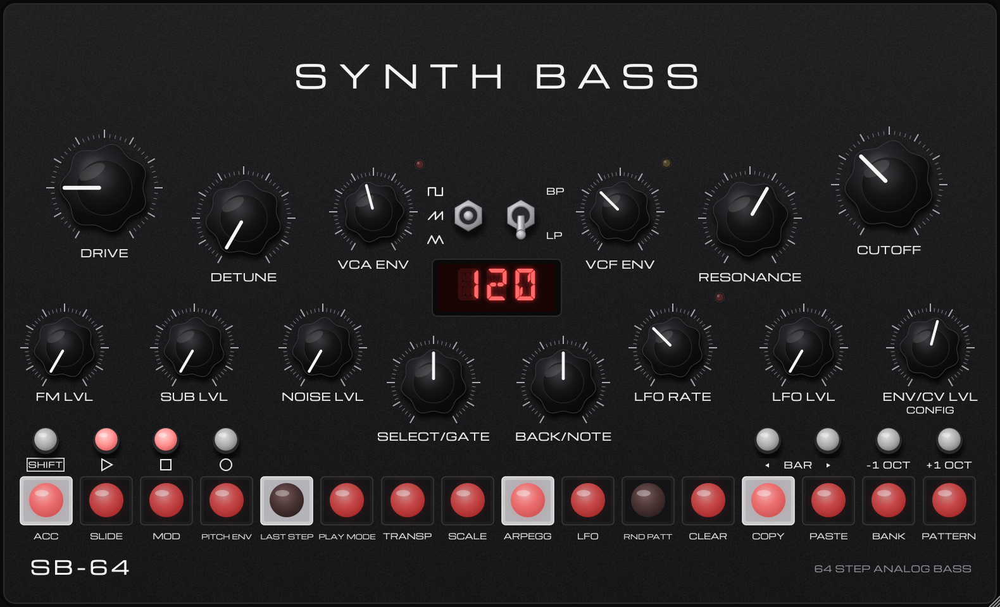

# SB-64 – Handbuch

*English: [Manual](Manual.md)*



SB-64 ist ein analog klingender, monophoner Acid-Bass-Synthesizer mit eingebautem 64-Step-Sequencer.
Ein Oszillator, ein Sub, Rauschen, ein rotziges Zwei-Pol-Filter und ein Sequencer, der pro Step Gate,
Accent, Slide, Filter-Versatz, Pitch-Hüllkurve, Wahrscheinlichkeit und Feinstimmung kennt – alles über
eine einzige Frontplatte, ohne Untermenüs zum Durchklicken.

> **Stand:** in Entwicklung. Was hier steht, ist eingebaut und getestet; der Feinschliff am Klang
> kommt noch.

---

## Inhalt

1. [Warum SB-64?](#1-warum-sb-64)
2. [Installation](#2-installation)
3. [Erste Schritte](#3-erste-schritte)
4. [So entsteht der Klang](#4-so-entsteht-der-klang)
5. [Die Frontplatte](#5-die-frontplatte)
6. [Das Menü (SELECT / NOTE)](#6-das-menü-select--note)
7. [Sequencer](#7-sequencer)
8. [SHIFT-Funktionen](#8-shift-funktionen)
9. [Skalen und User-Skalen](#9-skalen-und-user-skalen)
10. [Arpeggiator](#10-arpeggiator)
11. [Patterns, Banks und Ketten](#11-patterns-banks-und-ketten)
12. [MIDI und Host-Sync](#12-midi-und-host-sync)
13. [Unbedingt ausprobieren](#13-unbedingt-ausprobieren)
14. [Parameterliste](#14-parameterliste)
15. [Probleme lösen](#15-probleme-lösen)

---

## 1. Warum SB-64?

Die meisten Acid-Plugins wollen *die eine* Silberkiste aus den 80ern nachbauen. SB-64 nicht. Vorbild ist
eine kompakte analoge Bassline-Box aus dem Jahr 2020, die bewusst anders klingt – und genau das macht
den Reiz aus:

- **Das Filter beißt.** Kein weiches Ladder-Filter, sondern ein Zwei-Pol-State-Variable-Filter nach einer
  rauen Schaltung aus den 80ern: Integratoren, die nicht beliebig schnell können (Slew-Limiting), etwas
  Übernahmeverzerrung, Resonanz bis zur Selbstoszillation – **ohne dass der Bass dabei wegbricht**. Es
  klingt dreckig, instabil, lebendig. Tiefpass *und* Bandpass.
- **DRIVE ist kein Gain-Regler.** Er blendet vom sauberen Signal in eine Übersteuerungsstufe über: unten
  leicht angeraut, oben komplett kaputt – und die Tiefen werden dabei fetter statt dünner.
- **DETUNE ist kein zweiter Oszillator.** Zwei modulierte Delay-Lines im Stil alter Eimerketten-Chips
  legen sich übers Signal. Das ergibt kein sauberes Schweben, sondern einen pulsierenden Schwarm –
  von leichtem Chorus bis Supersaw-Matsch.
- **Die LFO geht bis in den Audiobereich.** Über FM LVL moduliert sie die Tonhöhe bis 2 kHz: metallisch,
  glockig, kaputt. Dazu zehn Formen, darunter drei eigenwillige Rhythmus-Formen.
- **Der Slide ist eigen.** Kein klassisches Acid-Gleiten, sondern eine Kurve, die schnell losläuft und weich landet –
  und wie lang er wirkt, hängt vom Gate ab.
- **Der Sequencer ist eine Groovebox für sich:** 64 Steps, Wahrscheinlichkeiten und „spiel nur jede
  achte Runde“-Bedingungen, fünf Laufrichtungen, Skalen inkl. eigener microtonaler, Arpeggiator,
  Zufallsgenerator, Pattern-Ketten. Lines entstehen hier durchs Rumspielen, nicht durchs Programmieren.
- **Drone-Modus.** VCA ENV ganz auf – der Ton hört nie auf. Perfekt zum Schrauben am Filter.

Kurz: SB-64 ist für alle, die Acid mögen, aber nicht noch einen Klon wollen.

---

## 2. Installation

SB-64 gibt es als **AU** (nur macOS), **VST3**, **CLAP** und als **Standalone-App**.

| System | Ordner |
|---|---|
| macOS AU | `~/Library/Audio/Plug-Ins/Components/` |
| macOS VST3 | `~/Library/Audio/Plug-Ins/VST3/` |
| macOS CLAP | `~/Library/Audio/Plug-Ins/CLAP/` |
| macOS Standalone | `~/Applications/` |
| Windows VST3 | `C:\Program Files\Common Files\VST3\` |
| Windows CLAP | `C:\Program Files\Common Files\CLAP\` |
| Linux VST3 / CLAP | `~/.vst3/` / `~/.clap/` |

Danach in der DAW die Plugins neu scannen. SB-64 ist ein Instrument (Synth, mono).

### Plugins auf macOS freigeben

Heruntergeladene, nicht von Apple notarisierte Plugins blockiert macOS gern („kann nicht geöffnet
werden“, „ist beschädigt“) oder die DAW überspringt sie. Abhilfe im **Terminal**, danach DAW neu starten:

```bash
xattr -dr com.apple.quarantine ~/Library/Audio/Plug-Ins/Components/SB-64.component ~/Library/Audio/Plug-Ins/VST3/SB-64.vst3 ~/Library/Audio/Plug-Ins/CLAP/SB-64.clap
```

Nur bei Quellen machen, denen du vertraust.

---

## 3. Erste Schritte

1. SB-64 auf eine Instrumentenspur legen.
2. **PLAY** (das Dreieck) drücken. Im ersten Pattern **A1** liegt eine kleine Acid-Line.
   - Im Plugin steht die Uhr ab Werk auf **Host**: PLAY blinkt, bis die DAW läuft. Standalone läuft
     sofort mit eigenem Tempo.
3. An **CUTOFF**, **RESONANCE**, **VCF ENV** und **ENV/CV LVL** drehen – das ist der Acid-Kern.
4. **DRIVE** langsam aufziehen. Dann **DETUNE**.
5. Eine Step-Taste klicken: Der Step geht an und blinkt. **BACK/NOTE** dreht seinen Ton,
   **SELECT/GATE** seine Länge. Noch ein Klick auf denselben Step schaltet ihn aus.

Bedienhilfen für die Maus:

- Knöpfe: ziehen; mit **Shift** fein; **Doppelklick** = Grundwert; Mausrad geht auch.
- Encoder (SELECT/GATE, BACK/NOTE): ziehen oder Mausrad, mit **Shift** fein, **Klick** = Taster.
- **SHIFT** auf der Frontplatte rastet ein: einmal drücken (leuchtet), dann eine Step-Taste. Alternativ
  mit gedrückter Computer-Shift-Taste auf eine Step-Taste klicken.
- Beim Anfassen eines Knopfs zeigt das Display kurz seinen Wert.

---

## 4. So entsteht der Klang

```
VCO (Square / Saw / Tri) ──► Detune ─┐
Sub (Square, −1 Okt)  ───────────────┼──► Filter (LP/BP) ──► VCA ──► Drive ──► Out
Noise ───────────────────────────────┘        ▲     ▲         ▲
                                    VCF ENV ──┘     │         └── VCA ENV
                         LFO ──► Cutoff (LFO LVL)   └── MOD-Spur / Accent
                         LFO ──► Tonhöhe (FM LVL)
```
- **Accent** macht den Ton lauter, öffnet das Filter etwas weiter und verlängert beide Hüllkurven ein
  Stück. Er ist an oder aus, kein Mengenregler.
- **Slide** gleitet zum nächsten Ton, die Hüllkurven laufen dabei weiter. **Gate 100 %** verbindet zwei
  Töne ohne neuen Anschlag (legato), aber ohne Gleiten.
- Die **Pitch-Hüllkurve** springt am Notenanfang nach oben (bis drei Oktaven) und fällt schnell zurück –
  der klassische „Peow“.

---

## 5. Die Frontplatte

### Obere Reihe

| Regler | Was er tut |
|---|---|
| **DRIVE** | Überblendung sauber ↔ Übersteuerung. |
| **DETUNE** | Menge der zwei modulierten Delay-Lines (Schwarm/Chorus). |
| **VCA ENV** | Ausklingzeit der Lautstärke, 40 ms bis 5 s. Ganz rechts **INF**: Drone, der Ton hält ewig. |
| **Wellen-Schalter** | Rechteck / Sägezahn / Dreieck. |
| **Filter-Schalter** | **BP** (Bandpass) / **LP** (Tiefpass). |
| **VCF ENV** | Ausklingzeit der Filterhüllkurve, 30 ms bis 3 s. |
| **RESONANCE** | Filterresonanz bis zur Selbstoszillation. |
| **CUTOFF** | Filterfrequenz, ca. 30 Hz bis 17,6 kHz. |

### Untere Reihe

| Regler | Was er tut |
|---|---|
| **FM LVL** | Wie stark die LFO die Tonhöhe moduliert. |
| **SUB LVL** | Lautstärke des Sub-Oszillators (Rechteck eine Oktave tiefer). |
| **NOISE LVL** | Weißes Rauschen ins Filter. |
| **SELECT/GATE** | Encoder: ist ein Step gewählt, sein Gate (bzw. Wahrscheinlichkeit/Cent, s. u.); sonst blättert er durchs Menü. |
| **BACK/NOTE** | Encoder: Ton des gewählten Steps, sonst Wert des Menüpunkts. **Klick = BACK**. |
| **LFO RATE** | LFO-Tempo frei 0,05 Hz bis 2 kHz – oder mit SYN an in Notenwerten. |
| **LFO LVL** | Wie stark die LFO das Filter moduliert. |
| **ENV/CV LVL** | Wie stark die Filterhüllkurve den Cutoff öffnet. |

### Display und LEDs

- Das dreistellige Display zeigt normalerweise das **Tempo**, beim Drehen den Wert, im Menü Name und
  Wert, beim Schreiben eines Steps seinen Ton.
- **Rote LED links** neben dem Wellen-Schalter: Gate. **Gelbe LED rechts** neben dem Filter-Schalter:
  Accent – und sie blitzt bei Übersteuerung (Clip). **Rote LED** bei LFO RATE: blinkt im LFO-Takt.

### Taster

| Taster | Funktion |
|---|---|
| **SHIFT** | Zweitfunktionen der Step-Tasten (rastet ein). |
| **▷ PLAY** | Sequencer starten. Blinkt, wenn er auf den Host wartet. |
| **□ STOP** | Stoppen. Im Stand nochmal: zurück an den Anfang. |
| **○ REC** | Aufnahme an/aus. **SHIFT + REC**: Keyboard-Modus. |
| **◂ BAR ▸** | Welcher der vier Takte (16 Steps) auf den Tasten liegt. |
| **−1 OCT / +1 OCT** | Gewählten Step um eine Oktave verschieben – sonst die Oktave der Tasten-Klaviatur. |

---

## 6. Das Menü (SELECT / NOTE)

Alles ohne eigenen Knopf liegt im Menü. **SELECT/GATE** drehen (ohne gewählten Step) blättert, das
Display zeigt kurz den Namen (z. B. `SWG`) und dann den Wert. **BACK/NOTE** ändert den Wert. Nach
fünf Sekunden ohne Bedienung geht das Menü wieder zu, ein Klick auf BACK/NOTE schließt es sofort.

Reihenfolge: `BPM CLK SWG PLY TRP SCL KEY MSL ARP ADR AOC AGT ARH ASR DNS RAC RSL ROC RMD LFO SYN RNG
RST PHS SLD ACC PED PET BND TUN VOL`. Was jeder Punkt tut: [Parameterliste](#14-parameterliste).

Viele SHIFT-Funktionen springen direkt an die richtige Stelle (SHIFT + LFO → `LFO`, SHIFT + PLAY MODE
→ `PLY` usw.).

---

## 7. Sequencer

### Steps schreiben

Die 16 Step-Tasten zeigen einen Takt des gewählten Patterns. Leuchtend = Step spielt, hell = gerade
dran. Mit **◂ BAR ▸** auf Takt 2–4 wechseln; während der Sequencer läuft, folgt die Anzeige dem
Abspielpunkt, bis du BAR drückst.

- **Klick auf einen leeren Step:** schaltet ihn an und wählt ihn (blinkt).
- **NOTE** dreht seinen Ton (C0–C6), **±1 OCT** springt Oktaven, **GATE** setzt die Länge (10–100 %).
- **Klick auf SELECT/GATE** schaltet um, was GATE ändert:
  `GAT` (Gate) → `PRB` (Wahrscheinlichkeit) → `CNT` (Feinstimmung ±50 Cent) → wieder `GAT`.
- **Noch ein Klick auf den gewählten Step:** schaltet ihn aus.
- **BACK** verlässt den Step.

### Wahrscheinlichkeit (PRB)

| Wert | Bedeutung |
|---|---|
| `ALL` | spielt immer |
| `10` `25` `50` `75` `90` | spielt mit dieser Wahrscheinlichkeit in % |
| `1/8` … `7/8` | spielt in den ersten 1…7 von je acht Durchläufen – `1/8` = nur jede achte Runde, `7/8` = in der achten Runde Pause |

### Länge, Laufrichtung, Tempo

- **SHIFT + LAST STEP**, dann eine Step-Taste: letzter Step des Patterns (auch in Takt 2–4).
- **SHIFT + PLAY MODE**: Laufrichtung `FWD` vorwärts, `BWD` rückwärts, `RND` zufällig, `PP` Ping-Pong
  (Enden einmal), `PP2` Ping-Pong mit doppelten Enden.
- Tempo `BPM` 20–480 (bei eigener Uhr), `SWG` Swing 0–50 % auf jedem zweiten 16tel.

### Aufnehmen (REC)

Mit **REC** werden die Step-Tasten zur Klaviatur (ab C2, ±1 OCT verschiebt). Computer-Shift beim
Klicken = Accent. Töne per MIDI-Keyboard gehen genauso.

- **Gestoppt:** Step-Aufnahme. Jeder Ton landet im nächsten Step, das Display zeigt das Ziel (`R5`).
  Beginnt am gewählten Step.
- **Laufend:** Live-Aufnahme, auf den nächsten Step quantisiert.
- Mit eingeschaltetem **Arpeggiator** werden dessen Töne aufgenommen – so schreibst du Lines per Arp.

### Keyboard-Modus

**SHIFT + REC** macht die Step-Tasten zur Klaviatur, ohne aufzunehmen (`KBD`). Nochmal SHIFT + REC
oder BACK beendet ihn. Gebundenes Spielen (Taste halten, nächste drücken) gleitet; wie lange, stellt
**MSL** (Master Slide) im Menü ein: `OFF` = Slide-Zeit `SLD`, 10–100 = Anteil eines 16tels im Tempo.

---

## 8. SHIFT-Funktionen

| Taste | SHIFT + Taste |
|---|---|
| 1 **ACC** | Tasten setzen/löschen Accents. BACK beendet. |
| 2 **SLIDE** | Tasten setzen/löschen Slides. |
| 3 **MOD** | Taste wählt einen Step, **NOTE** stellt seinen Cutoff-Versatz −64…+63 ein (SELECT in groben Schritten). Steps mit Versatz leuchten. |
| 4 **PITCH ENV** | Taste wählt einen Step, **NOTE** = Tiefe 1–9 (`PE5`), **SELECT** = Abklingzeit 0–9 (`DC4`). Tiefe aus = die Pitch-Hüllkurve aus dem Menü (`PED`/`PET`). |
| 5 **LAST STEP** | Dann Step-Taste: letzter Step. |
| 6 **PLAY MODE** | Öffnet `PLY`. |
| 7 **TRANSP** | Öffnet `TRP`: transponiert den Sequencer (±24 Halbtöne) und den Arp. |
| 8 **SCALE** | Werks-Skala: öffnet `SCL`. User-Skala: Skalen-Editor (s. u.). |
| 9 **ARPEGG** | Arpeggiator an/aus. |
| 10 **LFO** | Öffnet die LFO-Einstellungen (`LFO`, dann weiterblättern). |
| 11 **RND PATT** | Würfelt das Pattern neu (zwischen erstem und letztem Step). |
| 12 **CLEAR** | Dann nochmal CLEAR: Pattern löschen. Jede andere Taste bricht ab. |
| 13 **COPY** | Pattern kopieren. |
| 14 **PASTE** | Kopiertes Pattern einfügen. |
| 15 **BANK** | Dann Taste 1–8: Bank A–H. |
| 16 **PATTERN** | Dann Taste 1–16: Pattern der Bank. Weitere Tasten direkt danach bauen eine Kette. |

**BACK** (Klick auf BACK/NOTE) verlässt Schritt für Schritt: wartende Funktion → Menü → gewählter Step
→ Tasten-Modus (ACC/SLIDE/MOD/…) → Keyboard-Modus.

---

## 9. Skalen und User-Skalen

`SCL` wählt die Skala, `KEY` den Grundton. Alle Töne des Sequencers (nach dem Transponieren), des
Zufallsgenerators und des Arps (Quelle `SCL`) werden auf den nächsttieferen Skalenton gelegt.

Werks-Skalen: `CHR` chromatisch, `MAJ` Dur, `MIN` Moll, `PMA` Dur-Pentatonik, `PMI` Moll-Pentatonik,
`WHL` Ganzton, `BMA` Dur-Blues, `BMI` Moll-Blues.

### User-Skalen U1–U16 (auch microtonal)

1. Im Menü `SCL` auf `U1`…`U16` stellen.
2. **SHIFT + SCALE**: Die Tasten 1–12 sind jetzt die zwölf Halbtöne ab dem Grundton (Taste 1 = Grundton).
   Leuchtend = gehört zur Skala.
3. Ein Druck auf einen Ton wählt ihn (blinkt), ein zweiter nimmt ihn raus. Ein Druck auf einen
   ausgeschalteten Ton nimmt ihn wieder auf. Der Grundton bleibt immer drin.
4. **NOTE** verstimmt den gewählten Ton um bis zu ±50 Cent (mit Shift in 1-Cent-Schritten). Damit gehen
   arabische Maqam-Skalen, reine Stimmung, schräge Gamelan-artige Leitern …
5. BACK beendet den Editor.

User-Skalen werden mit dem Projekt gespeichert.

---

## 10. Arpeggiator

**SHIFT + ARPEGG** schaltet ihn an. Dann spielt er gehaltene MIDI-Töne (oder im Keyboard-Modus die
Step-Tasten) in 16teln im Sequencer-Tempo ab, beginnend mit dem ersten Tastendruck.

| Menü | Werte |
|---|---|
| `ADR` Richtung | `UP`, `DN`, `UD` (hoch und runter), `RND` |
| `AOC` Oktaven | 1–3 |
| `AGT` Gate | 10–100 % |
| `ARH` Rhythmus | 1 jedes 16tel · 2 Achtel · 3 zwei an, eins aus · 4 3+3+2 · 5 drei an, eins aus · 6 eins aus, drei an |
| `ASR` Quelle | `KEY` die gehaltenen Töne · `SCL` die gewählte Skala ab dem tiefsten gehaltenen Ton |

`TRP` transponiert auch den Arp. Mit **REC** landen seine Töne im Pattern.

---

## 11. Patterns, Banks und Ketten

- 8 Banks (A–H) × 16 Patterns = 128 Patterns, alle werden **mit dem Projekt gespeichert**.
- **SHIFT + BANK**, Taste 1–8 wechselt die Bank (gleiche Pattern-Nummer).
  **SHIFT + PATTERN**, Taste 1–16 wechselt das Pattern. Leuchtende Tasten = Patterns mit Inhalt.
- Während der Sequencer läuft, wechselt das neue Pattern erst am Ende des laufenden (Taste blinkt).
- **Kette:** Nach SHIFT + PATTERN und der ersten Taste innerhalb von 2,5 Sekunden weitere Tasten
  drücken (Display `CHN`, `C2`, `C3` …). Die Patterns laufen dann nacheinander, immer im Kreis. Ein
  normaler Pattern-Wechsel beendet die Kette. Ketten werden nicht gespeichert.
- **COPY / PASTE** kopieren ganze Patterns, auch zwischen Banks.

### Zufallsgenerator (RND PATT)

SHIFT + RND PATT füllt die Steps zwischen erstem und letztem Step neu – mit Tönen der Skala (`SCL`,
`KEY`) ab C2. Die Mischung stellst du vorher im Menü ein:

| Menü | Bedeutung |
|---|---|
| `DNS` | Dichte: Anteil der Steps, die spielen (10–90 %) |
| `RAC` | Anteil mit Accent |
| `RSL` | Anteil mit Slide |
| `ROC` | Tonumfang 1–3 Oktaven |
| `RMD` | zufälliger Cutoff-Versatz bis ± diesen Wert (0 = aus) |

Tipp: Gefällt dir ein Pattern, vorher **COPY** – dann kannst du weiterwürfeln und zurück.

---

## 12. MIDI und Host-Sync

- **MIDI-Noten** spielen SB-64 direkt: monophon, der zuletzt gedrückte Ton gewinnt. Gebunden gespielt
  gleitet er. Anschlagstärke ab `ACC` (Standard 100) = Accent. **Pitchbend** mit Bereich `BND`.
- **Uhr** `CLK`: `INT` = eigenes Tempo `BPM`; `HST` = folgt Tempo und Position der DAW (Loops und
  Springen inklusive). Mit HST wartet PLAY, bis die DAW läuft.
- Die **LFO** läuft mit `SYN` an im Takt: `RNG LO` 1/64 bis 8 Zyklen pro Viertel, `RNG HI` 1/16 bis 32.
  `RST` startet sie mit jedem neuen Ton neu, `PHS` legt die Startphase fest (0–315°).

---

## 13. Unbedingt ausprobieren

1. **Der Drone.** VCA ENV ganz rechts (`INF`), einen Ton halten, dann nur CUTOFF, RESONANCE und DRIVE.
   Hier hörst du am besten, was das Filter kann.
2. **Pfeifendes Filter.** RESONANCE fast ganz auf, Filter auf BP, Wellenform Dreieck, CUTOFF langsam
   fahren. Der Bass bleibt da, obendrüber singt die Resonanz.
3. **Metall-FM.** LFO RATE weit nach rechts (Audiobereich), Form `SIN` oder `SQR`, FM LVL langsam auf.
   Von Glocke über Funk-Störung bis Industrial.
4. **Schwarm-Bass.** Sägezahn, DETUNE auf halb, SUB LVL dazu, DRIVE ein Drittel. Fett, pulsierend.
5. **Peow-Percussion.** SHIFT + PITCH ENV, auf ein paar Steps Tiefe 6–9 mit kurzer Abklingzeit. Klingt
   nach Tom/Zap mitten in der Bassline.
6. **Fake-HiHat.** NOISE LVL auf, CUTOFF weit offen, DRIVE hoch, VCA ENV ganz kurz. Ein Step mit Accent.
7. **Rhythmische Filter-LFO.** LFO-Form `TAR`, `TDS` oder `DST` (Treppen-Rampen), `SYN` an, LFO LVL
   halb, dazu `RST` an. Jede Note bekommt ihren eigenen Filterverlauf.
8. **Lebendige Lines mit Wahrscheinlichkeit.** Ein paar Steps auf `50` oder `75`, einen auf `1/8` (Fill
   nur jede achte Runde). Die Line klingt nie zweimal gleich, bleibt aber erkennbar.
9. **Polymetrie.** LAST STEP auf 13 oder 7 stellen, dazu `PP2` – gegen eine 4/4-Drum läuft die Bassline
   ständig verschoben.
10. **Würfeln mit Skala.** `SCL MIN`, `KEY A`, `DNS 60`, `RSL 30`, dann SHIFT + RND PATT so oft, bis es
    knallt. COPY nicht vergessen.
11. **Slide-Gefühl.** Slide auf zwei Steps hintereinander, und dann am GATE des ersten drehen: Wie weit
    der Slide reicht, hängt vom Gate ab.
12. **Arp ins Pattern.** ARPEGG an, `ARH 4` (3+3+2), REC an (gestoppt), einen Akkord halten – fertig ist
    eine synkopierte Line. Dann einzelne Steps nachbearbeiten.
13. **Microtonal.** `SCL U1`, SHIFT + SCALE, ein paar Töne raus, die Terz um −14 Cent, die Septime um
    −31 Cent. Plötzlich klingt Acid ganz woanders.
14. **MOD-Spur als Filter-Accent.** SHIFT + MOD und auf Offbeats +30…+60 setzen – wie ein zweiter
    Accent, nur fürs Filter.

---

## 14. Parameterliste

### Knöpfe und Schalter

| Name | Bereich |
|---|---|
| Drive, Detune, Resonance, FM Level, Sub Level, Noise Level, LFO Level, Env Amount | 0–100 % |
| VCA Env | 40 ms – 5 s, ganz rechts INF |
| VCF Env | 30 ms – 3 s |
| Cutoff | ca. 30 Hz – 17,6 kHz |
| LFO Rate | 0,05 Hz – 2 kHz, synchron in Notenwerten |
| Wave | Square, Saw, Triangle |
| Filter | Band-pass, Low-pass |

### Menü

| Display | Parameter | Bereich |
|---|---|---|
| `BPM` | Tempo | 20–480 |
| `CLK` | Uhr | INT / HST |
| `SWG` | Swing | 0–50 % |
| `PLY` | Laufrichtung | FWD, BWD, RND, PP, PP2 |
| `TRP` | Transponieren | ±24 Halbtöne |
| `SCL` | Skala | CHR … BMI, U1–U16 |
| `KEY` | Grundton | C – B |
| `MSL` | Master Slide | OFF, 10–100 % eines 16tels |
| `ARP` | Arpeggiator | ON / OFF |
| `ADR` | Arp-Richtung | UP, DN, UD, RND |
| `AOC` | Arp-Oktaven | 1–3 |
| `AGT` | Arp-Gate | 10–100 % |
| `ARH` | Arp-Rhythmus | 1–6 |
| `ASR` | Arp-Quelle | KEY / SCL |
| `DNS` `RAC` `RSL` | Zufall: Dichte, Accents, Slides | % |
| `ROC` | Zufall: Oktaven | 1–3 |
| `RMD` | Zufall: Cutoff-Versatz | 0–64 |
| `LFO` | LFO-Form | SIN, TRI, SAW, RMP, SQR, TDS, DST, TAR, S-H, NOS |
| `SYN` | LFO synchron | ON / OFF |
| `RNG` | LFO-Bereich (synchron) | LO / HI |
| `RST` | LFO-Neustart pro Ton | ON / OFF |
| `PHS` | LFO-Startphase | 0–315° |
| `SLD` | Slide-Zeit (MIDI) | 10–500 ms |
| `ACC` | Accent ab Anschlag | 1–127 |
| `PED` | Pitch-Hüllkurve Tiefe (MIDI/Steps ohne eigene) | 0–9 |
| `PET` | Pitch-Hüllkurve Abklingzeit | 10–300 ms |
| `BND` | Pitchbend-Bereich | 0–12 Halbtöne |
| `TUN` | Stimmung | ±10 Hz um 440 Hz |
| `VOL` | Lautstärke | 0–100 |

### Pro Step

Ton C0–C6 · Gate 10–100 % · Accent · Slide · MOD −64…+63 · Pitch-Hüllkurve Tiefe 0–9 und
Abklingzeit 0–9 · Wahrscheinlichkeit/Bedingung · Feinstimmung ±50 Cent.

---

## 15. Probleme lösen

| Problem | Lösung |
|---|---|
| PLAY blinkt, aber nichts passiert | Uhr steht auf `HST` – DAW starten oder `CLK` auf `INT`. |
| Kein Ton bei MIDI | Ist der Arp an? Dann spielt er nur gehaltene Töne. VOL prüfen. |
| Ton hört nicht auf | VCA ENV steht auf `INF` (Drone) – Regler etwas zurück. |
| Tasten machen „komische“ Dinge | Noch in einem Modus (ACC, MOD, Skala, Keyboard …)? **BACK** so oft drücken, bis die Tasten wieder Steps zeigen. |
| Gelbe LED blitzt dauernd | Clip – VOL oder DRIVE runter. |
| Pattern weg | Patterns hängen am Projekt. Projekt nicht gespeichert? Dann leider weg. Vor RND PATT: COPY. |
